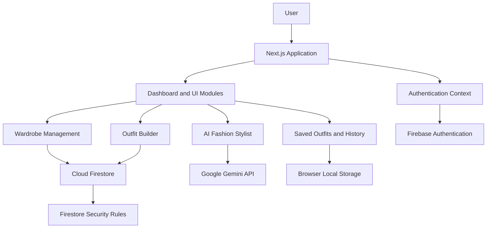

# AURA AI — AI-Powered Personal Fashion Assistant

<p align="center">
  
  
  
  
  
  
</p>

<p align="center">
  <strong>Your wardrobe. Your identity. Your style — powered by AI.</strong>
</p>

<p align="center">
  AURA AI is a personal fashion assistant designed to help users organize their wardrobe, explore fashion aesthetics, and receive personalized styling recommendations using generative AI.
</p>

<p align="center">
  <a href="https://github.com/manjunath-novus/ai-fashion">Repository</a> •
  <a href="#features">Features</a> •
  <a href="#getting-started">Getting Started</a> •
  <a href="#architecture">Architecture</a>
</p>

---

## Table of Contents

- [Overview](#overview)
- [Problem Statement](#problem-statement)
- [Features](#features)
- [Application Modules](#application-modules)
- [Technology Stack](#technology-stack)
- [Architecture](#architecture)
- [Project Structure](#project-structure)
- [Getting Started](#getting-started)
- [Environment Variables](#environment-variables)
- [Firebase Configuration](#firebase-configuration)
- [Security Considerations](#security-considerations)
- [Available Scripts](#available-scripts)
- [Current Implementation](#current-implementation)
- [Future Roadmap](#future-roadmap)
- [Contributing](#contributing)
- [Author](#author)

---

## Overview

AURA AI is an AI-powered fashion and wardrobe management application built with Next.js, Firebase, and Google's Generative AI SDK.

The application brings wardrobe organization and AI-assisted fashion guidance into one experience.

Users can manage clothing items in a digital wardrobe, explore fashion preferences, interact with an AI stylist, and build and save outfit combinations.

The goal is to make everyday fashion decisions more organized, personalized, and accessible.

## Problem Statement

Choosing outfits every day can be time-consuming. People often own many clothing items but lack an organized way to manage their collections or combine them into suitable outfits.

AURA AI addresses this problem by providing:

- A centralized digital wardrobe.
- Fashion preference and style exploration.
- AI-powered conversational styling assistance.
- Outfit building and saved outfit collections.
- A unified interface for personal fashion management.

## Features

### 1. Digital Wardrobe

Organize personal clothing items in one place.

- Upload clothing images.
- Organize items by category.
- Compress uploaded images before saving.
- Edit item names, categories, and styles.
- Delete wardrobe items.
- Search and filter clothing.
- Sort items by upload date.

Supported wardrobe categories include shirts, pants, shoes, jackets, hoodies, watches, chains, caps, perfumes, and bags.

### 2. AI Fashion Stylist

Get conversational fashion guidance through Google's Gemini model.

- Ask fashion and outfit-related questions.
- Receive styling suggestions.
- Provide wardrobe category context to the AI.
- Maintain conversation context during the current session.

The current implementation uses the `gemini-2.0-flash` model through the Google Generative AI SDK.

### 3. Outfit Builder

Explore outfit combinations using items from the digital wardrobe.

The repository includes a dedicated Outfit Builder module for assembling clothing combinations.

### 4. Saved Outfits

Keep selected outfit combinations in a personal collection.

The saved collection uses browser local storage for outfit records and retrieves associated wardrobe items from Firestore.

### 5. Outfit History

Review previously generated outfit combinations through a dedicated history interface.

### 6. Fashion Identity and Onboarding

Explore fashion preferences and aesthetics through the onboarding and identity-related modules.

Available style preferences include:

- Minimal
- Streetwear
- Luxury
- Casual
- Old Money
- Techwear

### 7. Dashboard and Analytics

The application includes dashboard and analytics modules for presenting personal fashion-related information.

### 8. Authentication

Google sign-in is implemented through Firebase Authentication.

The application uses an authentication context to track the current user session.

---

## Application Modules

| Module | Purpose |
|---|---|
| Dashboard | Main application overview |
| Wardrobe | Clothing uploads and collection management |
| Stylist | Conversational AI fashion assistance |
| Builder | Outfit combination interface |
| Saved | Saved outfit collection |
| History | Outfit history |
| Analytics | Fashion-related analytics interface |
| Avatar | Avatar-related interface |
| Identity | Fashion identity interface |
| Persona | Personal style interface |
| Onboarding | Style preference selection |
| Feed | Fashion feed interface |
| Login | Google authentication |

---

## Technology Stack

### Frontend

| Technology | Purpose |
|---|---|
| Next.js 16 | React framework and application routing |
| React 19 | User interface |
| TypeScript | Static typing |
| Tailwind CSS 4 | Styling and responsive layouts |
| Framer Motion | UI animations and transitions |
| Lucide React | Icons |

### Backend and Cloud Services

| Technology | Purpose |
|---|---|
| Firebase Authentication | Google sign-in |
| Cloud Firestore | Wardrobe data persistence |
| Google Generative AI SDK | Gemini model integration |

### Development Tools

| Tool | Purpose |
|---|---|
| Node.js | JavaScript runtime |
| npm | Package management |
| ESLint | Code quality and linting |
| Git | Version control |
| GitHub | Source code hosting |
| Vercel | Recommended deployment platform |

---

## Architecture

AURA AI follows a client-oriented Next.js architecture with Firebase services and a generative AI integration.



### Application Flow

1. Users access the Next.js application.
2. Firebase Authentication manages Google sign-in.
3. Authenticated users manage their personal wardrobe.
4. Wardrobe information is stored in Cloud Firestore.
5. The AI Stylist uses Gemini to generate conversational fashion guidance.
6. Outfit data is maintained through the application's saved outfit and history features.

---

## Project Structure

```text
ai-fashion/
│
├── public/
│   └── Static assets and SVG files
│
├── src/
│   │
│   ├── app/
│   │   ├── analytics/
│   │   ├── avatar/
│   │   ├── builder/
│   │   ├── components/
│   │   ├── dashboard/
│   │   ├── feed/
│   │   ├── history/
│   │   ├── identity/
│   │   ├── login/
│   │   ├── onboarding/
│   │   ├── persona/
│   │   ├── rating/
│   │   ├── saved/
│   │   ├── stylist/
│   │   ├── wardrobe/
│   │   ├── globals.css
│   │   ├── layout.tsx
│   │   └── page.tsx
│   │
│   ├── context/
│   │   └── AuthContext.tsx
│   │
│   └── firebase/
│       └── config.ts
│
├── firestore.rules
├── eslint.config.mjs
├── next.config.ts
├── package.json
├── package-lock.json
├── tsconfig.json
└── README.md
```

---

## Getting Started

Follow these steps to run AURA AI locally.

### Prerequisites

Install the following:

- Node.js (LTS version recommended).
- npm.
- Git.
- A Google account.
- A Firebase project.
- A Gemini API key.

### 1. Clone the repository

```bash
git clone https://github.com/manjunath-novus/ai-fashion.git
```

### 2. Navigate to the project

```bash
cd ai-fashion
```

### 3. Install dependencies

```bash
npm install
```

### 4. Configure environment variables

Create a `.env.local` file in the project root.

```env
NEXT_PUBLIC_GEMINI_API_KEY=your_gemini_api_key
```

Add the required Firebase configuration to `src/firebase/config.ts`, using your own Firebase project credentials.

### 5. Start the development server

```bash
npm run dev
```

### 6. Open the application

Visit:

```text
http://localhost:3000
```

The application should now be running locally.

---

## Environment Variables

| Variable | Description |
|---|---|
| `NEXT_PUBLIC_GEMINI_API_KEY` | Gemini API key used by the current browser-side Stylist integration |

**Important:** Variables prefixed with `NEXT_PUBLIC_` are exposed to the browser. The current implementation accesses the Gemini API key from client-side code. For production, move Gemini requests to a server-side API route or server action and use a private environment variable such as `GEMINI_API_KEY`.

Never commit private API keys or service account credentials to GitHub.

---

## Firebase Configuration

AURA AI uses Firebase Authentication and Cloud Firestore.

### Authentication

Enable Google as a sign-in provider in the Firebase Console.

Configure the authorized domains for your local and deployed application.

### Cloud Firestore

Create a Cloud Firestore database in your Firebase project.

The application stores wardrobe records in the `wardrobe` collection.

The current wardrobe data includes fields such as:

```text
wardrobe/
  documentId/
    userId
    image
    category
    name
    styles
    createdAt
```

### Firestore Security Rules

The repository includes a `firestore.rules` file.

The rules restrict wardrobe reads, updates, and deletes to the authenticated owner and validate ownership when creating or updating documents.

Deploy the rules to Firebase before using the application with real user data.

---

## Security Considerations

Security is important when handling personal wardrobe information and API credentials.

Recommended practices:

- Keep privileged API keys on the server.
- Do not commit `.env.local` files.
- Restrict Firebase API usage through appropriate project settings.
- Deploy Firestore Security Rules.
- Validate uploaded image types and sizes.
- Configure Firebase authorized domains.
- Review Firestore rules whenever new collections are introduced.

The current wardrobe upload implementation accepts JPEG, PNG, and WebP images up to 10 MB and compresses them in the browser before saving.

---

## Available Scripts

Run these commands from the project root.

| Command | Description |
|---|---|
| `npm install` | Install dependencies |
| `npm run dev` | Start the development server |
| `npm run build` | Create a production build |
| `npm run start` | Start the production server |
| `npm run lint` | Run ESLint |

---

## Current Implementation

The following distinction helps describe the repository accurately.

| Area | Implementation status |
|---|---|
| Next.js application structure | Implemented |
| Google authentication | Implemented |
| Firestore wardrobe persistence | Implemented |
| Wardrobe image upload and compression | Implemented |
| Wardrobe edit and delete operations | Implemented |
| Wardrobe search, filtering, and sorting | Implemented |
| Gemini-powered stylist integration | Implemented |
| Outfit Builder interface | Present |
| Saved outfit collection | Implemented using local storage |
| Outfit history interface | Present |
| Dashboard and analytics modules | Present |
| Avatar, identity, persona, and feed modules | Present |

A module being present in the repository does not necessarily mean every planned capability is complete or production-ready.

---

## Future Roadmap

Potential improvements for future development:

- Move Gemini requests to secure server-side endpoints.
- Add AI-generated outfit recommendations based on the complete wardrobe.
- Improve outfit generation using occasion, weather, and style preferences.
- Add persistent cloud storage for saved outfits and history.
- Introduce wardrobe image storage through Firebase Storage.
- Improve fashion analytics and wardrobe insights.
- Expand avatar and personalized fashion identity capabilities.
- Add automated tests and deployment workflows.
- Improve accessibility and mobile responsiveness.

---

## Contributing

Contributions and suggestions are welcome.

1. Fork the repository.
2. Create a feature branch.
3. Implement your changes.
4. Test the application.
5. Submit a pull request with a clear description.

```bash
git checkout -b feature/your-feature
```

---

## Author

**Manjunath Halli**

Computer Science Engineering Student | Software Development | AI & Cloud Computing

- GitHub: [@manjunath-novus](https://github.com/manjunath-novus)
- Repository: [ai-fashion](https://github.com/manjunath-novus/ai-fashion)

---

<p align="center">
  Built with Next.js, Firebase, and Google Gemini.
</p>

<p align="center">
  <strong>AURA AI — Style smarter. Dress better. Be yourself.</strong>
</p>
